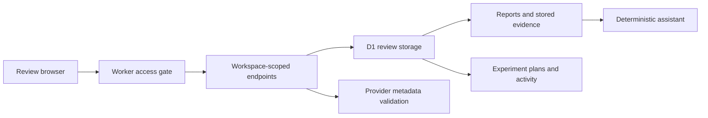

# Architecture and boundaries

The private application gates pages, assets, reports and APIs with a shared review login. Data queries carry a workspace selection. This arrangement separates review workspace data, but the shared identity can access all review workspaces; individual membership authorisation is a separate future requirement.

Configuration accepts provider-specific non-secret fields. Checking required fields and formats cannot authenticate with the provider, verify permissions, establish connectivity or prove data freshness. The public browser adaptation performs validation only and has no persistence.

The selected catalog covers GA4, Search Console and HubSpot configuration. No account values, configured properties or credentials are included. Search Console and CRM definitions are examples of planned connection metadata, not functioning ingestion providers.

Missing metrics remain unavailable. Automation forms store drafts rather than scheduling jobs. The private assistant retrieves saved evidence without generative inference. Neither this public excerpt nor the private review MVP claims full enterprise multi-tenancy or connected campaign/CRM ingestion.
