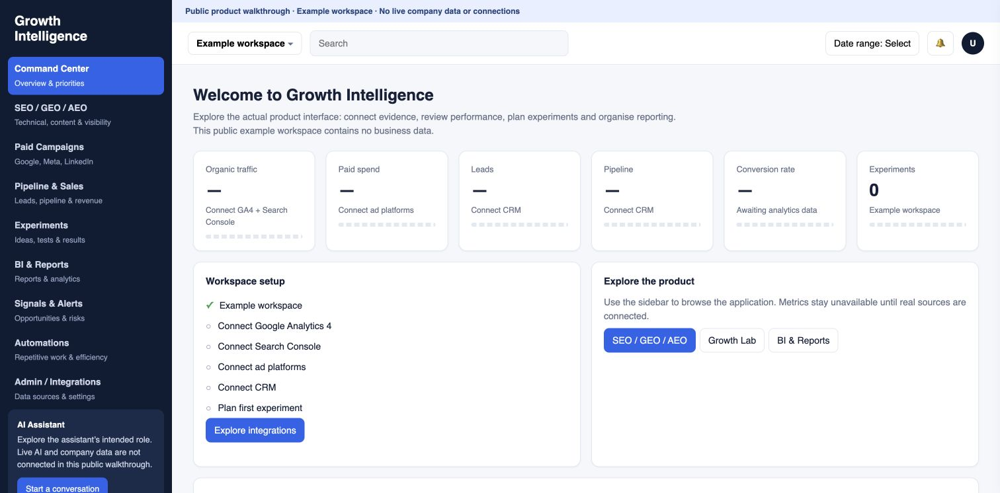

# Growth Intelligence — Product Walkthrough

**[Open the app preview →](https://ismail-bellakhel.github.io/growth-intelligence-showcase/)**

A workspace for connecting growth evidence, reviewing performance, planning experiments and organising reports. Designed and built by **Ismail Bellakhel**.

## Explore the product

The preview opens the application's interface, with its dashboard, navigation, tabs and reporting layouts. It uses an empty example workspace so recruiters can explore the product without access to company data.

- **Command Center:** see the overview, source setup and paths into the application.
- **SEO / GEO / AEO:** browse technical, content and answer-readiness review areas.
- **Paid Campaigns:** explore channel views, campaign reporting and source requirements.
- **Pipeline & Sales:** inspect the funnel, attribution views and account intelligence layout.
- **Experiments:** open the Growth Lab and try drafting an example experiment in memory.
- **BI & Reports:** explore report tabs and drag KPIs to organise a view.
- **Signals & Alerts:** review how evidence, recommendations and ownership are presented.
- **Automations:** explore recurring reporting and monitoring workflows.
- **Integrations:** browse source categories and connection states.

## What the preview includes

This is a public visual walkthrough using the real application's interface, adapted to remove the private company workspace and its audit. It does not connect to the private backend. Metrics remain unavailable rather than showing invented business results. Experiment examples remain in browser memory; report-order preferences apply only to the current browser tab.

The private review application includes persisted workspace settings, experiment plans, report views, activity and an evidence-retrieval assistant. Live advertising and CRM ingestion, generative inference and scheduled delivery are not presented as working in this public walkthrough.

## What this project demonstrates

Connecting growth strategy to practical product workflows: making missing evidence visible, bringing reporting into one workspace, structuring experiments and separating configuration from a working data connection.

The complete application, backend, database, deployment settings, credentials and company records remain private. This repository does not publish the private backend architecture. Browser-delivered interface files are visible in the same way as any website.

A small provider-validation code sample remains available separately in [sample.mjs](sample.mjs), with synthetic checks runnable using `npm test`.
